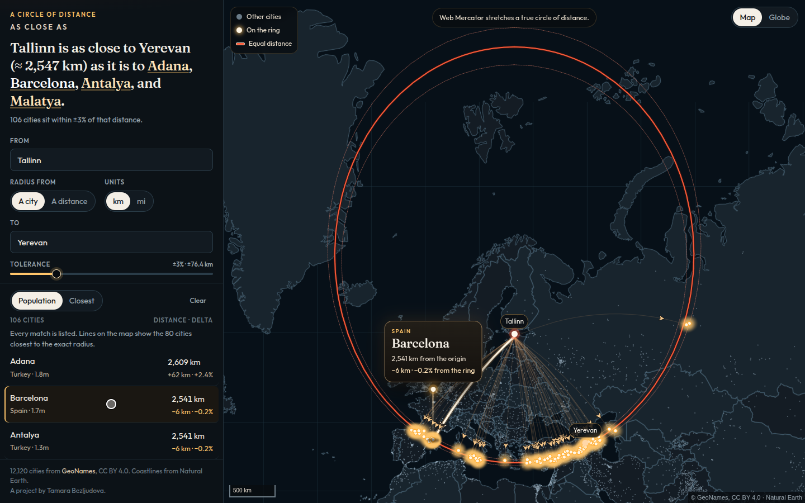

# As Close As

Tallinn is as close to Yerevan (≈ 2,547 km) as it is to Adana, Barcelona, Antalya, and Malatya.

As Close As is a small map for that kind of question. Pick a city, set a distance (or a second city), and it draws the true circle of places that far away. Cities on the ring light up. The rest stay dim. Choose one and it rises off the map, with the route from the origin drawn brighter than the others.

The app opens on a globe. The flat Mercator map is the other toggle, for when you want to see that same ring stretched.

The live map is at [https://tbezljudova-bit.github.io/as-close-as/](https://tbezljudova-bit.github.io/as-close-as/).




## Why a flat map fools you

Web Mercator is the usual web map. It keeps north up and angles locally true, and it stretches distances as you leave the equator. A real circle of equal distance, drawn on that map, becomes a tall oval. Greenland looks huge. A flight that feels "across Europe" on the screen may be the same length as one that looks much longer.

The ring in this app is not an oval drawn on the map. It is a set of points that are each the same great-circle distance from the origin. On the globe those points sit on a circle. Switch to the flat map and Mercator stretches that ring.

## How the distance is worked out

The earth is treated as a sphere with radius 6,371 km. The distance between two cities is the great-circle distance (the haversine formula): the shortest path along the surface, not a straight line through the planet and not a ruler line on the map.

The ring is that path spun all the way around the origin. A city matches when its own great-circle distance is within the tolerance of the target distance. The default tolerance is ±3%, and you can widen or narrow it. The sentence, the list, and the lit markers all come from that same calculation. Nothing is hard-coded. Tallinn to Yerevan comes out to about 2,547 km, and 106 cities in this set fall inside ±3% of that.

Distances can be shown in kilometres or miles. Sorting is by population, or by how close a city sits to the exact radius.

## Run it locally

You need Node.js. No API key, and no server of your own. The city list and the coastlines are bundled with the app.

```bash
npm install
npm run dev
npm test
```

Open [http://localhost:43123/as-close-as/](http://localhost:43123/as-close-as/). The first view is Tallinn to Yerevan.

`npm run build` writes a static site to `dist/`, with asset URLs under `/as-close-as/`. Pushes to `main` publish that folder to GitHub Pages.

`npm run prepare-data` rebuilds the city files from a GeoNames dump. The script expects `cities15000.txt`, `cities5000.txt`, and `countryInfo.txt` from [GeoNames](https://www.geonames.org/).

## Data and limitations

This map shows cities with 50,000+ people, plus every capital. For shorter trips, under 500 km, smaller towns of 5,000+ join in too. Distances are measured as the crow flies, in a straight line over the Earth's curve. City data comes from [GeoNames](https://www.geonames.org/) ([CC BY 4.0](https://creativecommons.org/licenses/by/4.0/)).

Every match is listed below. To keep the map readable, when there are more than 80 matches, lines are drawn to 80 of them, spread around the whole ring.

## License

MIT. Copyright (c) 2026 Tamara Bezljudova. See [LICENSE](LICENSE).
